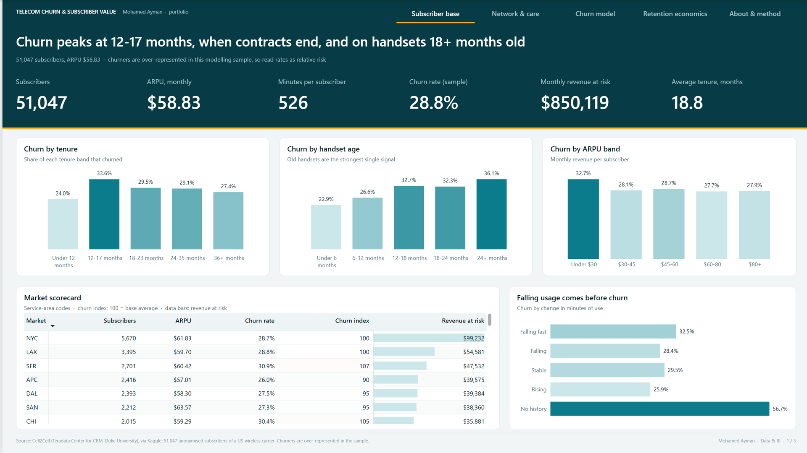
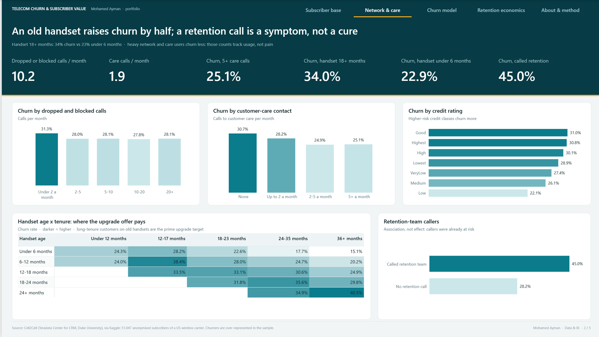
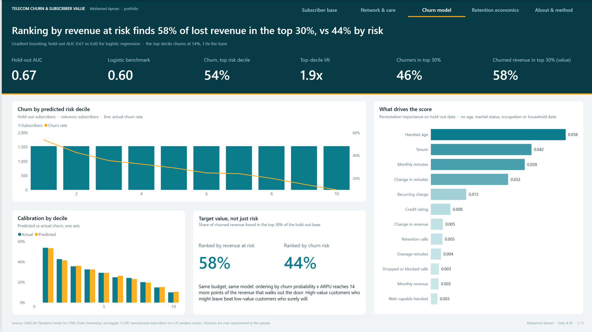
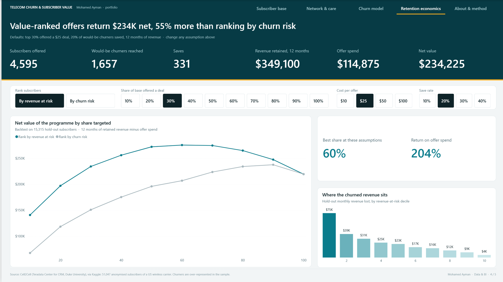
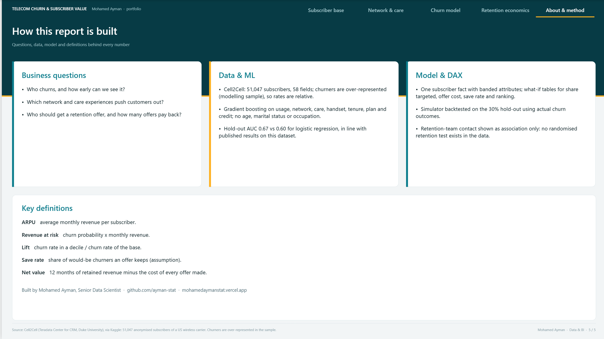

# Telecom Churn & Subscriber Value

How a mobile operator's CVM team decides who gets a retention offer: churn drivers, a churn model and a retention-economics simulator on 51K real subscribers.

**Domain:** Telecom / CVM  ·  **Built with:** Power BI Desktop (PBIP, PBIR, TMDL), DAX, Python  ·  **Author:** [Mohamed Ayman](https://mohamedaymanstat.vercel.app)



## What the data says

- Churn peaks at 12-17 months in service, when contracts end, and on handsets 18+ months old (34% vs 23% on new handsets).
- Customers who call the retention team churn at 45% vs 28%: a symptom, not a cure.
- Ranking by revenue at risk finds 58% of lost revenue in the top 30% of the base, vs 44% when ranking by churn risk.
- On the modelling sample, the simulator's defaults ($25 offer, 20% save rate) return $234K net. The sample over-represents churners (29%); reweighted to a realistic 2% monthly churn rate, the same campaign loses about $80K, and only a smaller offer aimed at positive expected value pays ([notebook 03](ds/notebooks/03_retention_economics.ipynb)). Measure the save rate in a test before scaling.

## Pages

| Page | Preview |
|---|---|
| 1. Subscriber base |  |
| 2. Network & care |  |
| 3. Churn model |  |
| 4. Retention economics |  |
| 5. About & method |  |

## Model and DAX

- Retention simulator with four what-if inputs (ranking method, share targeted, offer cost, save rate), backtested on the hold-out base.
- Net-value curve for both ranking methods and a measure that finds the best share under the chosen assumptions.

## Machine learning

- Gradient boosting on usage, network, care, handset, tenure, plan and credit features; no age, marital status or occupation.
- Hold-out AUC 0.67 vs 0.60 for logistic regression, in line with published results on this dataset.

## Data science

Three notebooks reproduce every model and simulator number in this report, then test them ([ds/README](ds/README.md), [model card](ds/model_card.md)):

- [01 EDA](ds/notebooks/01_eda.ipynb): sentinel codes, the drivers above with confidence intervals, collinearity, leakage decisions and what the over-sampled churn rate implies.
- [02 Churn model](ds/notebooks/02_churn_model.ipynb): the production model reproduced, then beaten by a tuned LightGBM (AUC 0.682 vs 0.672, paired CI +0.006 to +0.014); a prior correction to a real 2% monthly churn rate; SHAP and leakage refits.
- [03 Retention economics](ds/notebooks/03_retention_economics.ipynb): the $234K default holds on the modelling sample, but on a base churning 2% a month the same campaign loses money. The notebook covers expected-value targeting with cheap offers, sensitivity, a Monte Carlo band and the A/B test that would measure the save rate.

## Design

- Identity: **Telco**: a deep-teal hero band carries the action title and KPIs in white, amber marks the selected page.
- Every page states its finding as the title, names its source in the footer and uses readable field names.
- Value-driven colour (gradients) on bars, conditional formatting in tables, numbers right-aligned under right-aligned headers.
- Each report in this portfolio has its own visual identity; see the other repos linked below.

## Data

- [Cell2Cell (Teradata Center for CRM, Duke University)](https://www.kaggle.com/datasets/jpacse/datasets-for-churn-telecom): 51,047 anonymised subscribers of a US wireless carrier; churners are over-represented (modelling sample). Licence: Academic use.

The source licence does not allow redistribution, so `data/` is not committed. To rebuild it, download the source files into `.raw/` as described at the top of `etl/build_data.py`, then run the ETL.

## How to run

1. Open `TelecomChurnValue.pbip` in Power BI Desktop (October 2026 or later; PBIR and DAX user-defined functions).
2. Build the data (step below), set the `DataSource` parameter to `Local` and `LocalDataFolder` to this repo's `data\` folder, then refresh.
3. To rebuild everything from source:

```bash
pip install pandas numpy scikit-learn scipy openpyxl xlrd pyarrow
python etl/build_data.py      # source data -> data/*.csv (and models, where relevant)
python build/model.py         # writes the TMDL semantic model
python build/report.py        # writes the PBIR report
```

The report and model are generated from code (`build/`, using a shared design toolkit), so every visual, measure and page is reviewable in a diff.

## Limitations

- Churn rates are relative risk, not market churn, because the sample over-represents churners.
- Retention contact is observational: there is no randomised retention test in the data.

## More in this portfolio

- [Olist Marketplace Performance](https://github.com/ayman-stat/powerbi-olist-marketplace): E-commerce / marketplace
- [Retail Bank Campaign Strategy](https://github.com/ayman-stat/powerbi-bank-campaign-strategy): Banking / direct marketing
- [CVM Command Centre: retention, churn and offer experiments](https://github.com/ayman-stat/powerbi-cvm-experiments): CVM / retention / experimentation
- [Retail Network Performance](https://github.com/ayman-stat/powerbi-retail-network): Retail / store operations
- [Card Portfolio & Risk](https://github.com/ayman-stat/powerbi-card-portfolio-risk): Payments / cards / credit risk

---
Mohamed Ayman, Senior Data Scientist  ·  [Portfolio](https://mohamedaymanstat.vercel.app)  ·  [GitHub](https://github.com/ayman-stat)  ·  [LinkedIn](https://www.linkedin.com/in/mohamed-ghareb/)
