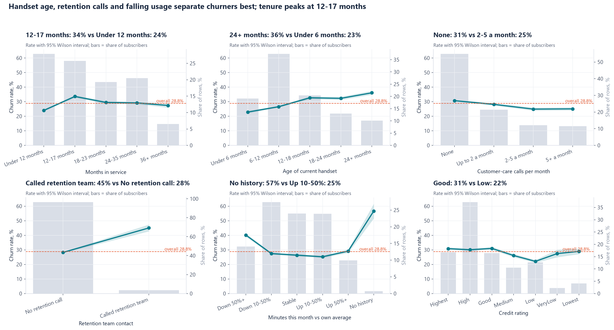
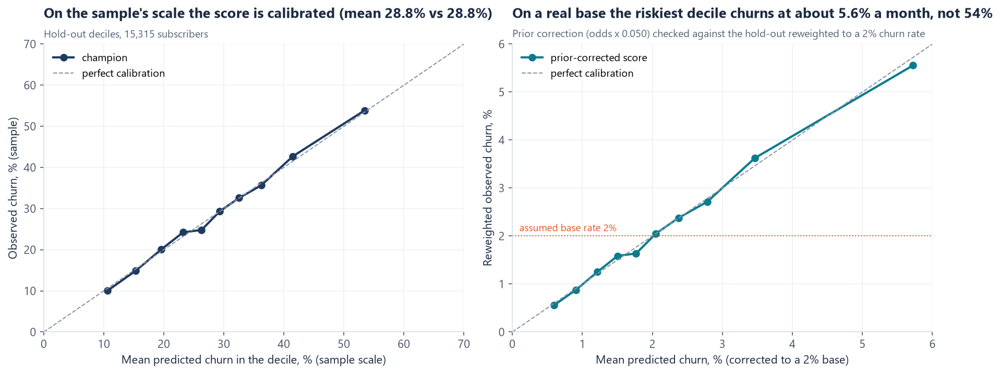
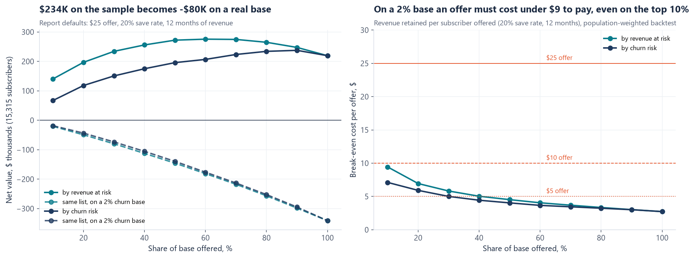
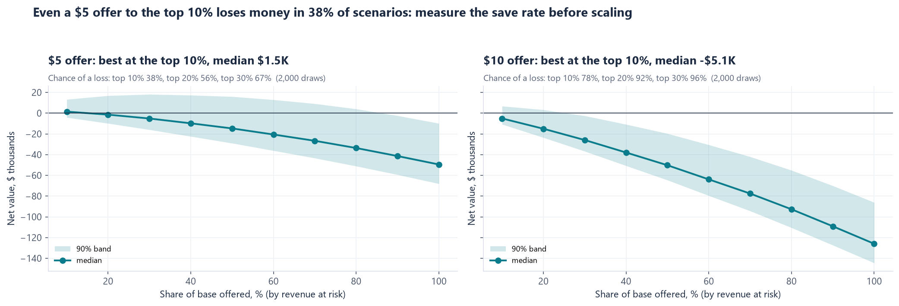

# Data science: churn model and retention economics

The Power BI report shows who is at risk and what a retention campaign could return. This folder shows how far to
trust those numbers. Three notebooks reproduce every model and simulator figure the report publishes, then challenge the
model and re-run the economics on a realistic churn rate.

## Lifecycle

| Stage | Notebook | Key output |
|---|---|---|
| Business understanding | [01 EDA](notebooks/01_eda.ipynb) §1 | Decision: who gets a retention offer, and how many offers to fund |
| Data understanding | [01 EDA](notebooks/01_eda.ipynb) | Sentinel codes sized (handset price unknown for 57%); README drivers reproduced; leakage decisions; the over-sampling and what it implies |
| Data preparation | [features.py](features.py), [02](notebooks/02_churn_model.ipynb) §2 | Engineered ratios (row-wise, tested); imputation, flags and transforms inside an sklearn pipeline |
| Modelling | [02 churn model](notebooks/02_churn_model.ipynb) | Production model reproduced (AUC 0.6722); five candidates on identical folds; tuned LightGBM challenger |
| Evaluation | [02](notebooks/02_churn_model.ipynb) | Bootstrap CIs and paired tests, prior correction to a 2% base, segment AUC, SHAP vs permutation, leakage refits, error analysis, learning curve |
| Decision | [03 retention economics](notebooks/03_retention_economics.ipynb) | Value vs risk ranking; the simulator on the sample and on a real base; EV targeting; tornado; Monte Carlo; save-rate test design |
| Deployment | [model_card.md](model_card.md) | Intended use, monitoring thresholds, retraining and the hold-out that measures causal value |

## Results

| Question | Answer | Evidence |
|---|---|---|
| Does the production model reproduce? | Yes, exactly: AUC 0.6722 (train 0.7403), logistic 0.6011, top-decile churn 53.9% (lift 1.87), 45.9% of churners in the top 30% | Asserted against `data/model_metrics.csv` |
| Is there a better model? | Tuned LightGBM on 48 inputs: AUC 0.682 (CI 0.674-0.692), +0.010 over the champion (CI +0.006 to +0.014), top-decile churn 56.0% | Paired bootstrap on the hold-out |
| Is 0.67 a weak model? | It is the data: best single-feature AUC 0.57; four model families land at 0.60-0.68; more rows add little | Notebook 02 §10 |
| Are the probabilities usable? | On the sample's scale, yes. On a real base they need the prior correction: the top decile churns at about 5.6% a month, not 54% | Notebook 02 §5 |
| Does the model lean on retention calls? | No: removing them costs 0.002 AUC | Leakage refit |
| Rank by value or by risk? | By revenue at risk: 58.0% of churned revenue in the top 30%, vs 44.1% | Reproduced from the report |
| Is the default campaign worth $234K? | On the over-sampled hold-out, yes (ROI 204%, best share 60%). On a 2% churn base it loses about $80K; offers must cost under about $9 even for the top decile | Population-weighted backtest |
| What should the team do? | Cheap offers ($2.50-$5) to subscribers with positive expected value ($6.2K per 15K subscribers at $5, against $6.5K expected), after a randomised test of the save rate (about 10,700 per arm) | Notebook 03 §5-8 |

## Key figures

| | |
|---|---|
|  |  |
|  |  |

More: [correlation](figures/01-correlation.png), [model comparison](figures/02-model-comparison.png),
[SHAP](figures/02-shap.png), [learning curve](figures/02-learning-curve.png), [value vs risk](figures/03-value-vs-risk.png),
[tornado](figures/03-tornado.png).

## Reproduce

Cell2Cell is distributed for academic use and is not redistributed. Download `cell2celltrain.csv` into `.raw/` (see the
top of `etl/build_data.py`), then from the repo root:

```bash
pip install pandas numpy scikit-learn scipy statsmodels lightgbm optuna shap matplotlib jupytext nbconvert ipykernel
python etl/build_data.py                         # data/*.csv for the report
python -m jupytext --set-kernel python3 --to ipynb --execute ds/notebooks/01_eda.py
python -m jupytext --set-kernel python3 --to ipynb --execute ds/notebooks/02_churn_model.py
python -m jupytext --set-kernel python3 --to ipynb --execute ds/notebooks/03_retention_economics.py
ruff check ds tests && pytest -q                 # lint + unit tests (synthetic data, no raw file needed)
```

Runtimes on a laptop with 4 threads: about 30 seconds (01), 4-6 minutes (02, mostly the Optuna search) and 20 seconds
(03). The `.py` files are the reviewable source (jupytext percent format); the `.ipynb` files are the executed versions.
In keeping with the data licence, the notebooks show profiles and aggregates, never subscriber rows.

## Layout

```
ds/
  features.py      loading, the ETL's design matrix and split, engineered ratios, bands, prior correction, simulator
  dskit/           shared helpers used across the portfolio (audit, EDA, evaluation, explainability, model selection)
  notebooks/       01 EDA, 02 churn model, 03 retention economics (.py source + executed .ipynb)
  figures/         the charts above
  reports/metrics.json   headline numbers written by the notebooks
  model_card.md
tests/test_features.py   design matrix, engineered ratios, bands, split, prior correction, population weights, simulator
```
